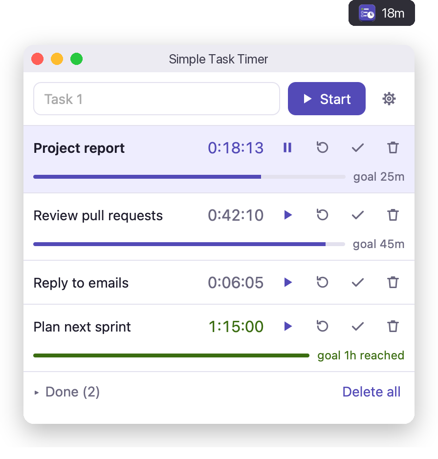
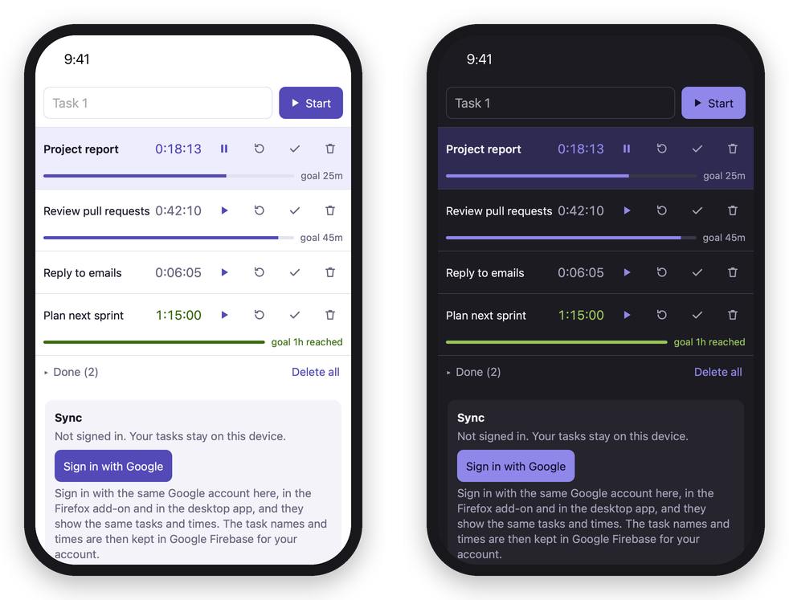
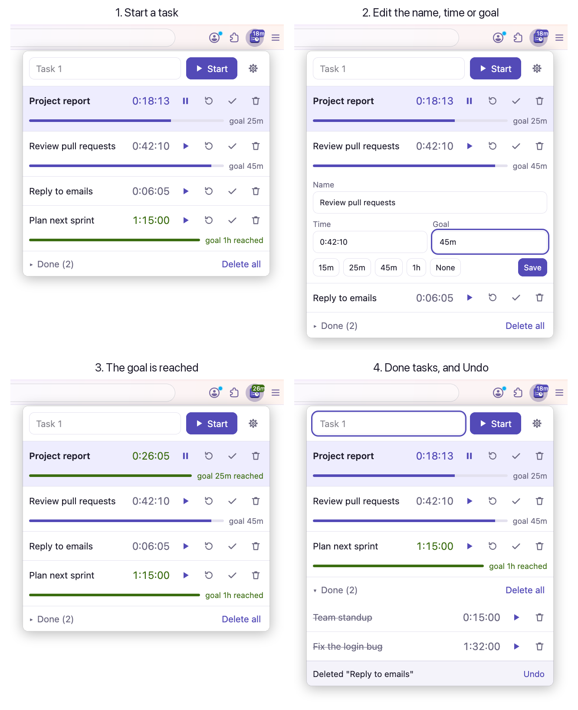

<p align="center">
  
</p>

<h1 align="center">Simple Task Timer</h1>

<p align="center">
  Time your tasks with one click: on your Mac, in Firefox and on your phone.<br>
  Sign in with Google, and the same tasks and times are on all your devices.
</p>

<p align="center">
  <a href="https://github.com/ishassan/simple-task-timer/releases/latest"></a>
  <a href="https://addons.mozilla.org/firefox/addon/simple-task-timer/"></a>
  <a href="https://simple-task-timer-e196ff.web.app"></a>
  <a href="LICENSE"></a>
</p>

<p align="center">
  
  
</p>

## Features

- **One click to start.** Press Enter or Start. Only one task runs; the task that was running pauses.
- **Goals.** Give a task a goal. At the goal you get one alert (Mac and Firefox), and the timer keeps counting.
- **Undo.** Reset, done and delete act at once, and you can undo them for 6 seconds.
- **The time is always in view.** In the Firefox toolbar, and in the Mac menu bar.
- **Keyboard first.** Alt+W (Option+W on a Mac) opens it in Firefox, and from any app with the Mac app. All keys can be changed.
- **Sync.** Sign in with Google, and your tasks are the same on all your devices. Without sign-in, nothing leaves your device.

## Get it

| Where | How |
| --- | --- |
| **Mac** | Download the app from [Releases](https://github.com/ishassan/simple-task-timer/releases/latest). |
| **Firefox** (computer and Android) | Install the add-on from [Firefox Add-ons](https://addons.mozilla.org/firefox/addon/simple-task-timer/). |
| **iPhone** (and other browsers) | Open [simple-task-timer-e196ff.web.app](https://simple-task-timer-e196ff.web.app) in Safari, then Share, Add to Home Screen. |

The Mac app is not notarized by Apple. The first time you open it, macOS stops it: open System Settings, Privacy & Security, and click **Open Anyway**.

## How it works

<p align="center">
  
</p>

- Click a task to change its name, time or goal. Done tasks go to a folded "Done" group.
- To add time or take time away, write `+` or `-` and a duration in the Time field: `+5m`, `-5m`, `+1h`, `-30s`. With 1:00:00 on the timer, `+5m` makes it 1:05:00. The time does not go below 0.
- The gear button opens Preferences: the keys, and Sync.
- Keys in the list: Space starts or pauses, E edits, R resets, D marks done, Delete deletes, Ctrl+Z (Cmd+Z) undoes.

### Sync

Sign in with the same Google account on each device. A change shows at once in the desktop app and the web version, and in Firefox when you open the popup. When two devices change the same task, the newer change wins.

Your task names and times are kept in Google Firebase, and only your account can read them. In Firefox for Android, the sign-in goes through the web version, because Firefox for Android has no Google sign-in for add-ons. See the [privacy policy](https://addons.mozilla.org/firefox/addon/simple-task-timer/privacy/).

## Repository

One app, with a folder for each place it runs:

| Folder | What it is |
| --- | --- |
| [`app/`](app) | The app itself: the task list, Preferences, the task logic and sync. Every version uses these files. |
| [`firefox/`](firefox) | The Firefox add-on: its manifest, build and browser tests. |
| [`desktop/`](desktop) | The Mac app, made with [Tauri](https://tauri.app). |
| [`web/`](web) | The web version for the iPhone, on Firebase Hosting. |
| [`firebase/`](firebase) | Sync: the Firestore rules, the Firebase bundle, and the emulator tests. |
| [`tests/`](tests) | Unit tests of `app/`. |
| [`docs/`](docs) | The design of the desktop app and sync, and the README images. |

Each folder's README has its build and test steps. First make the Firebase bundle, which all versions need:

```bash
cd firebase && npm install && npm run bundle
```

Unit tests (Node.js 20 or newer):

```bash
node --test
```

## License

Copyright (C) 2026 Islam Hassan. Simple Task Timer is free software under the [GNU General Public License v3.0](LICENSE).
